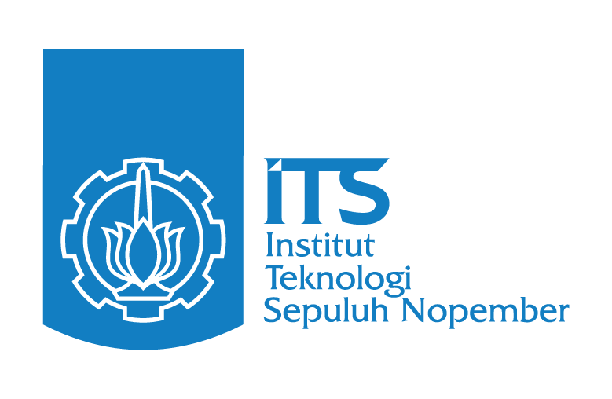

# Institut Teknologi Sepuluh Nopember (ITS)

**Advancing Humanity**

Welcome to the official GitHub organization of Institut Teknologi Sepuluh Nopember (ITS). Guided by the spirit of Advancing Humanity, we share software, research artifacts, educational resources, and open technologies that contribute to science, engineering, industry, and society.

## What we share

- **Open-source software** developed across faculties, departments, research centers, laboratories, and student organizations.
- **Research resources** such as datasets, experimental code, benchmarks, scientific software, and research prototypes to support reproducibility.
- **Educational materials** including course resources, programming assignments, tutorials, and laboratory modules.
- **Innovation projects** that may explore areas such as AI, robotics, smart cities, maritime technology, sustainability, energy systems, and digital transformation.

Together, these efforts support ITS's core mission areas of education, research, innovation, and community service.

## Explore ITS

- [ITS official website](https://www.its.ac.id/)
- [ITS English website](https://www.its.ac.id/en/)
- [Admissions](https://admission.its.ac.id/)
- [Official brand guidelines and assets](https://www.its.ac.id/en/about/brand-guidelines/)

For official visual identity, please use the logo and colors provided in the [ITS brand guidelines](https://www.its.ac.id/en/about/brand-guidelines/).
